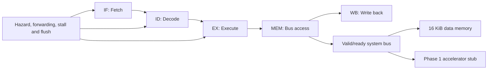

# Pipelined RV32I RISC-V CPU with Matrix Workloads and a Planned Systolic Accelerator

This repository contains a five-stage RV32I processor, its verification environment, matrix-multiplication software, and image-processing application experiments. Phase 1 implements and verifies matrix multiplication on the RISC-V CPU. Phase 2 will replace the current accelerator stub with a real systolic-array accelerator and compare both implementations under the same workloads.

## Project status

| Phase | Scope | Status |
|---|---|---|
| Phase 1 | Five-stage RV32I CPU, hazards, forwarding, SoC bus, memory, matrix software, JPEG/DCT and grayscale validation | Implemented and verified in Vivado/XSim |
| Phase 2 | Memory-mapped matrix/systolic-array accelerator, CPU integration, cycle/resource/timing comparison | Planned; accelerator RTL is not yet implemented |

> The current `accelerator_stub.sv` verifies the SoC address window and bus protocol only. It is not the Phase 2 accelerator.

## Architecture



The processor uses IF, ID, EX, MEM and WB stages with inter-stage pipeline registers. Pipeline control handles load-use hazards, forwarding, memory wait states, redirects, stalls and flushes. The MEM stage presents a valid/ready request-response interface to the SoC bus.

## Phase 1 contents

- Five-stage, 32-bit RV32I CPU
- Register forwarding and load-use hazard detection
- Branch/jump redirects, pipeline stalls and flushes
- Valid/ready data bus with access-fault propagation
- Address decoder, 16 KiB data memory and accelerator placeholder
- Signed 16-bit matrix operands and signed 32-bit saturated results
- Functional matrix tests and 8x8, 16x16 and 32x32 performance tests
- Fixed-point Q12 JPEG DCT validation
- Full-image RGB-to-grayscale validation using RTL CPU matrix jobs
- Python applications for JPEG, grayscale and AI colourization

## Repository layout

```text
phase1_riscv_cpu/
├── rtl/                 Synthesizable CPU and SoC SystemVerilog
├── testbenches/         Unit, CPU, SoC and matrix testbenches
├── software/            Assembly, machine code and matrix-input utility
├── applications/        JPEG, grayscale and AI colourization software
├── scripts/             Vivado Tcl and Windows launchers
├── constraints/         Timing and top-level constraints
└── results/             Preserved verification and synthesis evidence

phase2_systolic_accelerator/
└── README.md            Frozen objectives and planned architecture

docs/
└── module_documentation/README.md
```

See [Phase 1 documentation](phase1_riscv_cpu/README.md) and the [complete module map](docs/module_documentation/README.md).

## Verified results

### Matrix multiplication

| Workload | CPU cycles | Verification |
|---|---:|---|
| 8x8 | 119,001 | Passed |
| 16x16 | 945,679 | Passed |
| 32x32 | 7,540,727 | Passed |

The matrix dimensions are programmable up to 32. Matrix A and B use signed 16-bit elements; products are signed 32-bit; accumulation is wider internally; final signed 32-bit results use saturation with an overflow flag.

### Full-image grayscale

| Measurement | Result |
|---|---:|
| Resolution | 1200 x 1600 |
| Pixels processed by RTL CPU | 1,920,000 |
| Matrix jobs | 60,000 |
| Scalar multiplications | 5,760,000 |
| CPU cycles | 1,363,860,000 |
| Estimated compute time at 100 MHz | 13.6386 s |
| XSim host elapsed time | 27,665.950 s |
| Maximum CPU sum error | 0 |
| Failed pixels | 0 |

Every pixel was processed by the simulated RTL CPU using

```text
gray = (77R + 150G + 29B + 128) // 256
```

The hardware-time value is calculated from cycles at an assumed 100 MHz. It excludes image I/O, data transfer, Python preparation and file saving. XSim wall time is verification time, not FPGA execution time.

| Input | RTL-verified grayscale output |
|---|---|
|  |  |

[Full grayscale report](phase1_riscv_cpu/results/grayscale/full_image_grayscale_validation.txt)

### JPEG/DCT validation

For the 32x32 grayscale crop test:

| Measurement | Result |
|---|---:|
| 8x8 blocks | 16 |
| RTL matrix multiplications | 32 |
| CPU cycles | 3,713,550 |
| Estimated time at 100 MHz | 37.1355 ms |
| Maximum CPU-vs-Python coefficient error | 0 |
| Maximum CPU-vs-OpenCV coefficient error | 1 |
| Reconstructed-image PSNR | 27.788798 dB |

| Input | Compressed Q70 | Reconstructed output |
|---|---|---|
|  |  |  |

[JPEG/DCT result reports](phase1_riscv_cpu/results/jpeg)

## Application boundary

- JPEG: the full-resolution encoder uses the Python Q12 fixed-point implementation; a real crop is validated on the RTL RISC-V CPU.
- Grayscale: the preserved 1200x1600 validation processed every pixel through RTL simulation. The normal interactive application uses Python for practical execution speed.
- AI colourization: OpenCV DNN executes the pretrained model on the laptop CPU. The AI model does not run on the current RISC-V CPU.

These boundaries prevent software execution, RTL simulation and estimated FPGA timing from being reported as the same measurement.

## Tools used

- AMD Vivado/XSim 2026.1
- SystemVerilog
- RV32I assembly and machine code
- Python 3.11
- NumPy 1.26.4
- OpenCV 4.11.0
- Pillow, imageio and pandas

The large colourization `.caffemodel`, Python virtual environment and Vivado-generated build directories are intentionally excluded from Git.

## Phase 2

Phase 2 will implement the real memory-mapped matrix accelerator with control/status registers, operand/result buffers, a processing-element array and completion/overflow reporting. CPU-only and accelerator executions will use the same matrices, fixed-point rules and clock assumption.

See [Phase 2 plan](phase2_systolic_accelerator/README.md).

## Current reproducibility note

The repository preserves the tested RTL, testbenches, programs and original execution scripts. Some copied Tcl, batch and Python scripts still refer to the original local Vivado project layout. A portable repository-relative Vivado project-creation script is the next repository task; until it is added and regression-tested, the existing scripts should be treated as preserved Phase 1 sources rather than universally portable launchers.

