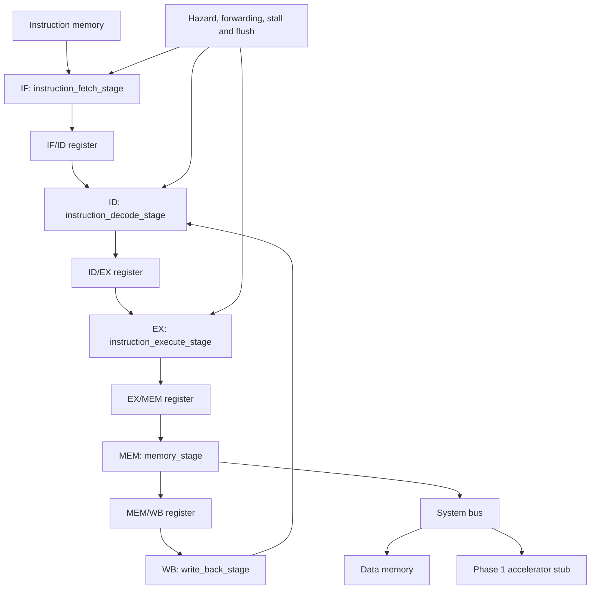

# Phase 1 RTL Module Documentation

This document describes every synthesizable Phase 1 SystemVerilog module using the same seven labels: **What**, **Why**, **How**, **Inputs**, **Outputs**, **Connected to**, and **Tested by**. Signal names are grouped where several signals form one interface; the linked RTL remains the exact port-level reference.

## Whole Phase 1 module flow

## CPU top

### `riscv_cpu`

- **What:** The complete five-stage, 32-bit RV32I processor core.
- **Why:** It provides one integration boundary for instruction execution, pipeline control and the external data-bus interface.
- **How:** It instantiates the IF, ID, EX, MEM and WB stages, all pipeline registers, and pipeline-control logic; it feeds redirects and write-back results to earlier stages.
- **Inputs:** `clk`, `reset`, `external_halt`, data-bus ready/response/read-data/access-fault signals.
- **Outputs:** Data-bus request/write/address/data/byte-enable signals plus halt, stall, flush, retirement, exception, register-write, PC, hazard and redirect status.
- **Connected to:** Instruction memory internally; `system_bus` externally; all Phase 1 CPU stages and control modules internally.
- **Tested by:** [`tb_riscv_cpu.sv`](../../phase1_riscv_cpu/testbenches/cpu/tb_riscv_cpu.sv) and [`tb_rv32i_regression.sv`](../../phase1_riscv_cpu/testbenches/cpu/tb_rv32i_regression.sv).
- **Source:** [`riscv_cpu.sv`](../../phase1_riscv_cpu/rtl/cpu_top/riscv_cpu.sv)

## Instruction Fetch (IF)

### `program_counter`

- **What:** A 32-bit register holding the current instruction address.
- **Why:** The CPU must track which instruction is being fetched.
- **How:** On reset it loads `RESET_PC`; when `pc_enable` is asserted it captures `next_pc`; otherwise it holds its value.
- **Inputs:** `clk`, `reset`, `pc_enable`, `next_pc`.
- **Outputs:** `pc`.
- **Connected to:** `instruction_fetch_stage`, `pc_plus4`, instruction memory and redirect selection logic.
- **Tested by:** [`tb_program_counter.sv`](../../phase1_riscv_cpu/testbenches/unit/tb_program_counter.sv).
- **Source:** [`program_counter.sv`](../../phase1_riscv_cpu/rtl/instruction_fetch/program_counter.sv)

### `pc_plus4`

- **What:** A combinational 32-bit sequential-address adder.
- **Why:** RV32I instructions normally advance by four bytes.
- **How:** It continuously computes `pc + 4`.
- **Inputs:** `pc`.
- **Outputs:** `pc_next_sequential`.
- **Connected to:** `program_counter`, fetch-stage next-PC logic and the IF/ID path.
- **Tested by:** [`tb_pc_plus4.sv`](../../phase1_riscv_cpu/testbenches/unit/tb_pc_plus4.sv).
- **Source:** [`pc_plus4.sv`](../../phase1_riscv_cpu/rtl/instruction_fetch/pc_plus4.sv)

### `instruction_memory`

- **What:** Parameterized synchronous storage for RV32I machine-code words.
- **Why:** The processor needs a program source that returns one 32-bit instruction for a valid PC address.
- **How:** It translates an aligned address relative to `BASE_ADDR` into a word index, returns the initialized word, and flags invalid or out-of-range accesses.
- **Inputs:** `clk`, `reset`, `read_enable`, `address`.
- **Outputs:** `instruction`, `instruction_valid`, `instruction_fault`.
- **Connected to:** `instruction_fetch_stage`; initialized from the selected `.hex` program.
- **Tested by:** [`tb_instruction_memory.sv`](../../phase1_riscv_cpu/testbenches/unit/tb_instruction_memory.sv).
- **Source:** [`instruction_memory.sv`](../../phase1_riscv_cpu/rtl/instruction_fetch/instruction_memory.sv)

### `instruction_fetch_stage`

- **What:** The complete IF-stage controller and datapath.
- **Why:** Fetching requires coordinated PC updates, redirects, stalls, memory timing and delivery to Decode.
- **How:** It selects sequential or redirected PC values, requests instruction memory, buffers the response when necessary, and emits the IF/ID information.
- **Inputs:** `clk`, `reset`, `stall`, `redirect_valid`, `redirect_pc`.
- **Outputs:** `fetch_pc`, `if_id_pc`, `if_id_pc_plus4`, `if_id_instruction`, `if_id_valid`, `if_id_fault`.
- **Connected to:** `program_counter`, `pc_plus4`, `instruction_memory`, pipeline control and `if_id_pipeline_register`.
- **Tested by:** [`tb_instruction_fetch_stage.sv`](../../phase1_riscv_cpu/testbenches/unit/tb_instruction_fetch_stage.sv).
- **Source:** [`instruction_fetch_stage.sv`](../../phase1_riscv_cpu/rtl/instruction_fetch/instruction_fetch_stage.sv)

## Instruction Decode (ID)

### `instruction_decoder`

- **What:** A combinational instruction-field extractor.
- **Why:** Control and datapath logic need the opcode, register addresses and function fields separately.
- **How:** It slices the 32-bit instruction into RV32I fields while propagating validity and fetch-fault state.
- **Inputs:** `instruction`, `instruction_valid`, `instruction_fault`.
- **Outputs:** `opcode`, `rd`, `funct3`, `rs1`, `rs2`, `funct7`, `decode_valid`, `decode_fault`.
- **Connected to:** `instruction_decode_stage`, `control_unit`, `register_file` and hazard detection.
- **Tested by:** [`tb_instruction_decoder.sv`](../../phase1_riscv_cpu/testbenches/unit/tb_instruction_decoder.sv).
- **Source:** [`instruction_decoder.sv`](../../phase1_riscv_cpu/rtl/instruction_decode/instruction_decoder.sv)

### `register_file`

- **What:** The 32-entry, 32-bit RV32I integer register bank.
- **Why:** Instructions need two source operands and usually one architectural destination.
- **How:** It provides two asynchronous reads and one synchronous write; register `x0` remains zero and write/read bypassing supplies a just-written value when required.
- **Inputs:** `clk`, `reset`, two read addresses, `write_enable`, `write_address`, `write_data`.
- **Outputs:** `read_data_1`, `read_data_2`.
- **Connected to:** Decode-stage source reads and Write-Back-stage destination writes.
- **Tested by:** [`tb_register_file.sv`](../../phase1_riscv_cpu/testbenches/unit/tb_register_file.sv).
- **Source:** [`register_file.sv`](../../phase1_riscv_cpu/rtl/instruction_decode/register_file.sv)

### `immediate_generator`

- **What:** An RV32I immediate extractor and sign extender.
- **Why:** I-, S-, B-, U- and J-type instructions encode constants in different bit layouts.
- **How:** It rearranges the selected instruction fields according to `immediate_type`, sign-extends them to 32 bits and reports whether the selection is valid.
- **Inputs:** `instruction`, `immediate_type`.
- **Outputs:** `immediate`, `immediate_valid`.
- **Connected to:** `control_unit`, `instruction_decode_stage`, Execute operand selection and branch/jump logic.
- **Tested by:** [`tb_immediate_generator.sv`](../../phase1_riscv_cpu/testbenches/unit/tb_immediate_generator.sv).
- **Source:** [`immediate_generator.sv`](../../phase1_riscv_cpu/rtl/instruction_decode/immediate_generator.sv)

### `control_unit`

- **What:** The main RV32I instruction-control decoder.
- **Why:** Each instruction class needs a different combination of register, memory, ALU, branch and result controls.
- **How:** It decodes opcode and function fields, validates legal combinations, identifies source-register use, and generates control signals carried through the pipeline.
- **Inputs:** Instruction valid/fault state, `opcode`, `funct3`, `funct7`, `rs1`, `rd`, `system_immediate`.
- **Outputs:** Valid/illegal/fault state; register and memory controls; branch/jump controls; ALU-source, immediate-type, ALU-class and result-source controls; system/fence indicators.
- **Connected to:** `instruction_decoder`, `immediate_generator`, ID/EX path and hazard logic.
- **Tested by:** [`tb_control_unit.sv`](../../phase1_riscv_cpu/testbenches/unit/tb_control_unit.sv).
- **Source:** [`control_unit.sv`](../../phase1_riscv_cpu/rtl/instruction_decode/control_unit.sv)

### `instruction_decode_stage`

- **What:** The integrated Decode-stage datapath, control and ID/EX boundary.
- **Why:** Field extraction, operand reads, immediate creation and control generation must be coordinated before execution.
- **How:** It instantiates the decoder, control unit, immediate generator, register file and ID/EX register; it also exposes source-register information to hazard detection.
- **Inputs:** `clk`, `reset`, pipeline enable/flush, IF/ID values, and the Write-Back register-file interface.
- **Outputs:** Decode hazard information and all Execute-stage data/control signals prefixed `ex_`.
- **Connected to:** IF/ID outputs, Write Back, `pipeline_control` and `instruction_execute_stage`.
- **Tested by:** [`tb_instruction_decode_stage.sv`](../../phase1_riscv_cpu/testbenches/unit/tb_instruction_decode_stage.sv).
- **Source:** [`instruction_decode_stage.sv`](../../phase1_riscv_cpu/rtl/instruction_decode/instruction_decode_stage.sv)

## Execute (EX)

### `operand_muxes`

- **What:** Two combinational operand-selection multiplexers.
- **Why:** The ALU may require `rs1` or PC as operand A and `rs2` or an immediate as operand B.
- **How:** Control bits choose the appropriate 32-bit source for each ALU input.
- **Inputs:** `rs1_value`, `rs2_value`, `pc_value`, `immediate_value`, and the two select controls.
- **Outputs:** `operand_a`, `operand_b`.
- **Connected to:** Forwarded register values, ID/EX values and the ALU.
- **Tested by:** [`tb_operand_muxes.sv`](../../phase1_riscv_cpu/testbenches/unit/tb_operand_muxes.sv).
- **Source:** [`operand_muxes.sv`](../../phase1_riscv_cpu/rtl/instruction_execute/operand_muxes.sv)

### `alu_control`

- **What:** The detailed ALU-operation decoder.
- **Why:** The main control unit identifies an operation class, while `funct3` and `funct7` select the exact arithmetic or logical function.
- **How:** It maps the operation class and function fields to a four-bit ALU command and detects unsupported combinations.
- **Inputs:** `alu_operation_class`, `funct3`, `funct7`.
- **Outputs:** `alu_control_code`, `alu_control_valid`, `illegal_alu_control`.
- **Connected to:** `control_unit`, ID/EX fields and `alu`.
- **Tested by:** [`tb_alu_control.sv`](../../phase1_riscv_cpu/testbenches/unit/tb_alu_control.sv).
- **Source:** [`alu_control.sv`](../../phase1_riscv_cpu/rtl/instruction_execute/alu_control.sv)

### `alu`

- **What:** The 32-bit arithmetic and logic execution unit.
- **Why:** RV32I arithmetic, Boolean, shift, address and comparison operations require a common datapath.
- **How:** A combinational case on `alu_control` computes the result and comparison flags and reports an invalid operation code.
- **Inputs:** `operand_a`, `operand_b`, `alu_control`.
- **Outputs:** `result`, `zero`, `equal`, signed/unsigned less-than flags and `illegal_operation`.
- **Connected to:** `operand_muxes`, `alu_control`, branch comparison and the EX/MEM result path.
- **Tested by:** [`tb_alu.sv`](../../phase1_riscv_cpu/testbenches/unit/tb_alu.sv).
- **Source:** [`alu.sv`](../../phase1_riscv_cpu/rtl/instruction_execute/alu.sv)

### `branch_jump_logic`

- **What:** Branch-condition evaluation and control-flow target generation logic.
- **Why:** Branches, JAL and JALR must redirect instruction fetch correctly and reject illegal or misaligned targets.
- **How:** It compares source values according to `funct3`, forms PC-relative or register-relative targets, clears the JALR low bit, and emits redirect/error status.
- **Inputs:** Execute validity, branch/jump controls, `funct3`, `pc`, source values and `immediate`.
- **Outputs:** `branch_taken`, `redirect_valid`, `redirect_target`, target-misaligned and illegal-control indicators.
- **Connected to:** Execute-stage operands and the Fetch-stage redirect interface.
- **Tested by:** [`tb_branch_jump_logic.sv`](../../phase1_riscv_cpu/testbenches/unit/tb_branch_jump_logic.sv).
- **Source:** [`branch_jump_logic.sv`](../../phase1_riscv_cpu/rtl/instruction_execute/branch_jump_logic.sv)

### `instruction_execute_stage`

- **What:** The integrated Execute-stage datapath and EX/MEM boundary.
- **Why:** Operand selection, ALU decoding, computation, control-flow resolution and downstream control propagation must operate consistently.
- **How:** It combines operand muxes, ALU control, ALU, branch/jump logic and the EX/MEM register, merging local errors into the pipeline fault state.
- **Inputs:** `clk`, `reset`, enable/flush; ID/EX data and control; forwarded source values through the connected CPU datapath.
- **Outputs:** Branch/redirect information and all EX/MEM data/control outputs.
- **Connected to:** ID/EX path, forwarding logic, Fetch redirect input and `memory_stage`.
- **Tested by:** [`tb_instruction_execute_stage.sv`](../../phase1_riscv_cpu/testbenches/unit/tb_instruction_execute_stage.sv).
- **Source:** [`instruction_execute_stage.sv`](../../phase1_riscv_cpu/rtl/instruction_execute/instruction_execute_stage.sv)

## Pipeline Registers

### `if_id_pipeline_register`

- **What:** The state register between Instruction Fetch and Decode.
- **Why:** It allows Fetch and Decode to process different instructions concurrently.
- **How:** On each enabled clock it captures PC, PC+4, instruction, valid and fault; reset or flush clears the entry.
- **Inputs:** `clk`, `reset`, `enable`, `flush`, and the five `_in` Fetch values.
- **Outputs:** Corresponding `_out` values for Decode.
- **Connected to:** `instruction_fetch_stage` and `instruction_decode_stage`.
- **Tested by:** [`tb_if_id_pipeline_register.sv`](../../phase1_riscv_cpu/testbenches/unit/tb_if_id_pipeline_register.sv).
- **Source:** [`if_id_pipeline_register.sv`](../../phase1_riscv_cpu/rtl/pipeline_registers/if_id_pipeline_register.sv)

### `id_ex_pipeline_register`

- **What:** The wide state register between Decode and Execute.
- **Why:** Decoded operands, instruction fields and control signals must remain aligned while entering EX.
- **How:** It captures the complete ID/EX bundle when enabled, holds it during a stall and clears it on reset or flush.
- **Inputs:** `clk`, `reset`, `enable`, `flush`; valid/fault/illegal state; PC, immediate and register data; register/function fields; Execute, memory and Write-Back controls.
- **Outputs:** The corresponding registered `_out` bundle.
- **Connected to:** Decode outputs, `instruction_execute_stage`, forwarding and hazard logic.
- **Tested by:** [`tb_id_ex_pipeline_register.sv`](../../phase1_riscv_cpu/testbenches/unit/tb_id_ex_pipeline_register.sv).
- **Source:** [`id_ex_pipeline_register.sv`](../../phase1_riscv_cpu/rtl/pipeline_registers/id_ex_pipeline_register.sv)

### `ex_mem_pipeline_register`

- **What:** The state register between Execute and Memory.
- **Why:** ALU results, store data and memory/write-back controls must travel together to MEM.
- **How:** It captures the EX/MEM bundle when enabled, preserves it during a hold and clears it on reset or flush.
- **Inputs:** `clk`, `reset`, `enable`, `flush`; pipeline state, PC+4, ALU result, store data, destination/function fields and downstream controls.
- **Outputs:** The corresponding registered Memory-stage bundle.
- **Connected to:** Execute outputs, forwarding logic and `memory_stage`.
- **Tested by:** [`tb_ex_mem_pipeline_register.sv`](../../phase1_riscv_cpu/testbenches/unit/tb_ex_mem_pipeline_register.sv).
- **Source:** [`ex_mem_pipeline_register.sv`](../../phase1_riscv_cpu/rtl/pipeline_registers/ex_mem_pipeline_register.sv)

### `mem_wb_pipeline_register`

- **What:** The final pipeline register between Memory and Write Back.
- **Why:** The selected instruction state and possible ALU/load result must be stable for architectural commit.
- **How:** It registers validity/error state, PC+4, ALU result, memory data, destination register and Write-Back controls; reset or flush clears it.
- **Inputs:** `clk`, `reset`, `enable`, `flush` and the complete MEM/WB input bundle.
- **Outputs:** The corresponding registered Write-Back bundle.
- **Connected to:** `memory_stage`, forwarding source logic and `write_back_stage`.
- **Tested by:** [`tb_mem_wb_pipeline_register.sv`](../../phase1_riscv_cpu/testbenches/unit/tb_mem_wb_pipeline_register.sv).
- **Source:** [`mem_wb_pipeline_register.sv`](../../phase1_riscv_cpu/rtl/pipeline_registers/mem_wb_pipeline_register.sv)

## Memory (MEM)

### `load_store_control`

- **What:** The RV32I load/store formatter and alignment checker.
- **Why:** Byte, halfword and word accesses require different byte enables, store placement and load extension rules.
- **How:** It decodes `funct3`, checks address alignment, generates bus controls and extracts/sign- or zero-extends returned load data.
- **Inputs:** Memory-operation validity/read/write controls, `funct3`, address, store data and returned memory data.
- **Outputs:** Bus request/write controls, address/data/byte enables, formatted `load_data`, misalignment and illegal-operation flags.
- **Connected to:** `memory_stage` and the external system bus.
- **Tested by:** [`tb_load_store_control.sv`](../../phase1_riscv_cpu/testbenches/unit/tb_load_store_control.sv).
- **Source:** [`load_store_control.sv`](../../phase1_riscv_cpu/rtl/memory_stage/load_store_control.sv)

### `memory_stage`

- **What:** The pipelined MEM-stage controller for the valid/ready data bus.
- **Why:** Loads and stores can take multiple cycles, so the CPU must hold the transaction and stall correctly until a response arrives.
- **How:** An internal IDLE/WAIT/HOLD state machine issues formatted requests, waits for responses, merges bus/access errors and produces the MEM/WB result bundle.
- **Inputs:** `clk`, `reset`, enable/flush, EX/MEM bundle, bus ready/response/read-data/access-fault.
- **Outputs:** `memory_busy_out`, bus request/write/address/data/byte-enable, and the MEM/WB bundle.
- **Connected to:** EX/MEM, `load_store_control`, `system_bus`, pipeline control and MEM/WB.
- **Tested by:** [`tb_memory_stage.sv`](../../phase1_riscv_cpu/testbenches/unit/tb_memory_stage.sv).
- **Source:** [`memory_stage.sv`](../../phase1_riscv_cpu/rtl/memory_stage/memory_stage.sv)

### `data_memory`

- **What:** Parameterized byte-write-enabled SoC RAM.
- **Why:** Programs need storage for variables, stacks and matrix operands/results.
- **How:** It checks address range/alignment, applies per-byte writes on a request, returns word reads and produces response/access-fault status.
- **Inputs:** `clk`, `reset`, `request`, `write_enable`, `address`, `write_data`, `byte_enable`.
- **Outputs:** `response_valid`, `read_data`, `access_fault`.
- **Connected to:** The data-memory slave port of `system_bus` and matrix-program data.
- **Tested by:** [`tb_data_memory.sv`](../../phase1_riscv_cpu/testbenches/unit/tb_data_memory.sv) and [`tb_soc_data_memory.sv`](../../phase1_riscv_cpu/testbenches/soc/tb_soc_data_memory.sv).
- **Source:** [`data_memory.sv`](../../phase1_riscv_cpu/rtl/memory_stage/data_memory.sv)

## Write Back (WB)

### `write_back_mux`

- **What:** The final result-source multiplexer.
- **Why:** Different instructions write an ALU result, loaded memory data or PC+4.
- **How:** It selects one of the three 32-bit candidates using `result_source` and reports whether the encoding is valid.
- **Inputs:** `alu_result`, `memory_data`, `pc_plus4`, `result_source`.
- **Outputs:** `write_back_data`, `write_back_data_valid`.
- **Connected to:** MEM/WB outputs and `register_write_back_logic`.
- **Tested by:** [`tb_write_back_mux.sv`](../../phase1_riscv_cpu/testbenches/unit/tb_write_back_mux.sv).
- **Source:** [`write_back_mux.sv`](../../phase1_riscv_cpu/rtl/writeback_stage/write_back_mux.sv)

### `register_write_back_logic`

- **What:** Architectural commit and register-write qualification logic.
- **Why:** Faulting, illegal or non-writing instructions must never corrupt the register file, and retirement/status events must be reported accurately.
- **How:** It combines pipeline validity, error state, destination and selected-data validity to authorize writes; it also generates retirement, exception, system and fence events.
- **Inputs:** Pipeline state, register-write control/data/destination and system/fence indicators.
- **Outputs:** Register-file write interface and processor status events.
- **Connected to:** `write_back_mux`, Decode-stage register file, forwarding/status outputs.
- **Tested by:** [`tb_register_write_back_logic.sv`](../../phase1_riscv_cpu/testbenches/unit/tb_register_write_back_logic.sv).
- **Source:** [`register_write_back_logic.sv`](../../phase1_riscv_cpu/rtl/writeback_stage/register_write_back_logic.sv)

### `write_back_stage`

- **What:** The integrated final CPU pipeline stage.
- **Why:** Result selection, architectural register update and instruction retirement must occur at one controlled commit point.
- **How:** It combines `write_back_mux` with `register_write_back_logic` and exposes the committed value for register write-back and forwarding.
- **Inputs:** Complete MEM/WB pipeline bundle.
- **Outputs:** Register-file write interface, forwarding value/valid and retirement/exception/system/fence status.
- **Connected to:** MEM/WB, Decode register file, forwarding unit and CPU status outputs.
- **Tested by:** [`tb_write_back_stage.sv`](../../phase1_riscv_cpu/testbenches/unit/tb_write_back_stage.sv).
- **Source:** [`write_back_stage.sv`](../../phase1_riscv_cpu/rtl/writeback_stage/write_back_stage.sv)

## Hazard, Forwarding and Pipeline Control

### `hazard_detection_unit`

- **What:** A combinational load-use dependency detector.
- **Why:** A value being loaded in EX is not yet available for the immediately following dependent instruction.
- **How:** It compares valid Decode-stage source registers against the valid Execute-stage load destination, excluding unused sources, `x0` and invalid/faulting producers.
- **Inputs:** Decode validity/source-use/source addresses and Execute validity/error/load/write/destination information.
- **Outputs:** `load_use_hazard`.
- **Connected to:** Decode, ID/EX state and `stall_flush_control` through `pipeline_control`.
- **Tested by:** [`tb_hazard_detection_unit.sv`](../../phase1_riscv_cpu/testbenches/unit/tb_hazard_detection_unit.sv).
- **Source:** [`hazard_detection_unit.sv`](../../phase1_riscv_cpu/rtl/hazard_and_forwarding/hazard_detection_unit.sv)

### `forwarding_unit`

- **What:** Execute-operand bypass selection logic.
- **Why:** Dependent instructions should use recent results without waiting for normal register-file write-back whenever the value is already available.
- **How:** It compares EX source registers with EX/MEM and MEM/WB destinations, gives priority to the newest valid result, selects forwarded values and flags an unavailable matching source.
- **Inputs:** EX source-use/address/value information and EX/MEM plus MEM/WB forwarding metadata/data.
- **Outputs:** Forwarded source values, two selection codes and blocked-source flags.
- **Connected to:** ID/EX, EX/MEM, MEM/WB and Execute operands.
- **Tested by:** [`tb_forwarding_unit.sv`](../../phase1_riscv_cpu/testbenches/unit/tb_forwarding_unit.sv).
- **Source:** [`forwarding_unit.sv`](../../phase1_riscv_cpu/rtl/hazard_and_forwarding/forwarding_unit.sv)

### `stall_flush_control`

- **What:** Central stage-enable and flush policy logic.
- **Why:** Halt, memory wait, load-use hazards and redirects require different pipeline responses.
- **How:** It applies a fixed priority policy to freeze selected stages, insert a bubble or clear wrong-path entries, while generating stall/flush status.
- **Inputs:** `pipeline_halt`, `memory_busy`, `redirect_valid`, `load_use_hazard`.
- **Outputs:** PC and pipeline-register enables, pipeline-register flushes, `pipeline_stalled`, `pipeline_flushed`.
- **Connected to:** All pipeline registers, the PC and CPU monitoring outputs.
- **Tested by:** [`tb_stall_flush_control.sv`](../../phase1_riscv_cpu/testbenches/unit/tb_stall_flush_control.sv).
- **Source:** [`stall_flush_control.sv`](../../phase1_riscv_cpu/rtl/hazard_and_forwarding/stall_flush_control.sv)

### `pipeline_control`

- **What:** The integrated hazard, forwarding, stall and flush controller.
- **Why:** Pipeline correctness requires one coordinated decision point for dependencies, waits, redirects and halts.
- **How:** It instantiates hazard detection, forwarding and stall/flush control, routing stage metadata to their decisions and returning operands plus enables/flushes.
- **Inputs:** Global halt/memory/redirect conditions; Decode and Execute dependency information; EX/MEM and MEM/WB forwarding sources.
- **Outputs:** Forwarded operands/selections, blocked and load-use status, stage enables/flushes and pipeline status.
- **Connected to:** Every pipeline stage/register and the CPU top.
- **Tested by:** [`tb_pipeline_control.sv`](../../phase1_riscv_cpu/testbenches/unit/tb_pipeline_control.sv).
- **Source:** [`pipeline_control.sv`](../../phase1_riscv_cpu/rtl/hazard_and_forwarding/pipeline_control.sv)

## Basic SoC

### `address_decoder`

- **What:** The combinational memory-map selector.
- **Why:** One CPU address space must route each request to exactly one slave or report that the address is unmapped.
- **How:** It compares the request address against the defined RAM and accelerator ranges and produces mutually exclusive select signals.
- **Inputs:** `request_valid`, `address`.
- **Outputs:** `data_memory_select`, `accelerator_select`, `unmapped_address`.
- **Connected to:** `system_bus`, `data_memory` and `accelerator_stub`/future accelerator.
- **Tested by:** [`tb_address_decoder.sv`](../../phase1_riscv_cpu/testbenches/soc/tb_address_decoder.sv).
- **Source:** [`address_decoder.sv`](../../phase1_riscv_cpu/rtl/soc/address_decoder.sv)

### `system_bus`

- **What:** A one-master, two-slave valid/ready interconnect.
- **Why:** The CPU needs a stable protocol for accessing RAM and the memory-mapped accelerator window.
- **How:** It accepts and captures one master request, decodes its address, drives the selected slave, waits for its response and returns read data or an access fault.
- **Inputs:** `clk`, `reset`; complete master request; data-memory and accelerator responses.
- **Outputs:** Master ready/response; complete request channels for data memory and accelerator.
- **Connected to:** CPU `memory_stage`, `address_decoder`, `data_memory` and `accelerator_stub`.
- **Tested by:** [`tb_system_bus.sv`](../../phase1_riscv_cpu/testbenches/soc/tb_system_bus.sv).
- **Source:** [`system_bus.sv`](../../phase1_riscv_cpu/rtl/soc/system_bus.sv)

### `accelerator_stub`

- **What:** A Phase 1 placeholder peripheral occupying the future accelerator address window.
- **Why:** It verifies address decoding and bus transactions before the real Phase 2 accelerator exists.
- **How:** It responds to permitted accesses with deterministic register behaviour and flags unsupported addresses or byte-enable patterns.
- **Inputs:** `clk`, `reset`, `request`, `write_enable`, `address`, `write_data`, `byte_enable`.
- **Outputs:** `response_valid`, `read_data`, `access_fault`.
- **Connected to:** The accelerator slave port of `system_bus`; replaced by the Phase 2 accelerator top.
- **Tested by:** [`tb_accelerator_stub.sv`](../../phase1_riscv_cpu/testbenches/soc/tb_accelerator_stub.sv).
- **Source:** [`accelerator_stub.sv`](../../phase1_riscv_cpu/rtl/soc/accelerator_stub.sv)

### `basic_soc_top`

- **What:** The synthesizable Phase 1 system top module.
- **Why:** CPU, interconnect, RAM and accelerator address space must be wired as one complete FPGA-oriented system.
- **How:** It instantiates `riscv_cpu`, `system_bus`, `data_memory` and `accelerator_stub`, connects their request/response channels and exposes CPU status signals.
- **Inputs:** `clk`, `reset`, `external_halt`.
- **Outputs:** Halt, stall, flush, retirement, exception, system/fence, register-write, fetch-PC, memory-busy, hazard and redirect status.
- **Connected to:** Every top-level Phase 1 hardware block; this is the synthesis and end-to-end simulation top.
- **Tested by:** [`tb_basic_soc_top.sv`](../../phase1_riscv_cpu/testbenches/soc/tb_basic_soc_top.sv) plus the matrix-application testbenches.
- **Source:** [`basic_soc_top.sv`](../../phase1_riscv_cpu/rtl/soc/basic_soc_top.sv)

## Verification hierarchy

| Level | Purpose | Location |
|---|---|---|
| Unit | Exercises one RTL module with directed normal, boundary and error cases | [`testbenches/unit`](../../phase1_riscv_cpu/testbenches/unit) |
| CPU | Runs integrated CPU programs and RV32I regression cases | [`testbenches/cpu`](../../phase1_riscv_cpu/testbenches/cpu) |
| SoC | Verifies address decode, RAM, bus, stub and top-level transactions | [`testbenches/soc`](../../phase1_riscv_cpu/testbenches/soc) |
| Applications | Verifies manual, batch, performance and grayscale matrix workloads | [`testbenches/matrix_applications`](../../phase1_riscv_cpu/testbenches/matrix_applications) |

Phase 2 modules are intentionally not presented as completed RTL. Their interfaces and microarchitecture must be frozen before implementation.
