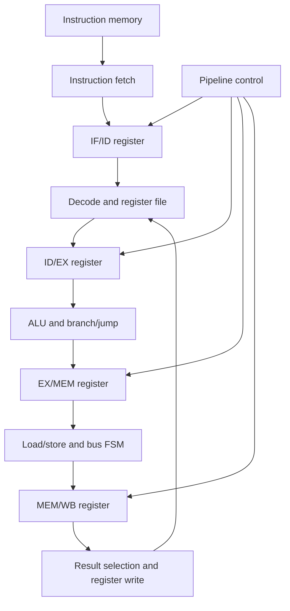

# Phase 1: Pipelined RV32I CPU and Matrix Applications

Phase 1 establishes the CPU-only baseline required for a fair Phase 2 accelerator comparison. It contains the synthesizable processor and SoC, module and integration testbenches, matrix software, application bridges and preserved verification evidence.

## Data and control flow



## CPU stages

| Stage | Main responsibilities | Main source |
|---|---|---|
| IF | PC update, PC+4, synchronous instruction memory, response buffering, redirects and stalls | [`instruction_fetch_stage.sv`](rtl/instruction_fetch/instruction_fetch_stage.sv) |
| ID | Instruction fields, control generation, immediate generation, register reads and ID/EX output | [`instruction_decode_stage.sv`](rtl/instruction_decode/instruction_decode_stage.sv) |
| EX | Operand selection, ALU control, ALU execution, branch/jump decision and redirect target | [`instruction_execute_stage.sv`](rtl/instruction_execute/instruction_execute_stage.sv) |
| MEM | Load/store formatting, misalignment checking and valid/ready bus transaction state machine | [`memory_stage.sv`](rtl/memory_stage/memory_stage.sv) |
| WB | ALU/memory/PC+4 result selection, register-file write qualification and retirement/status events | [`write_back_stage.sv`](rtl/writeback_stage/write_back_stage.sv) |

The integrated processor is [`riscv_cpu.sv`](rtl/cpu_top/riscv_cpu.sv).

## Pipeline control

[`pipeline_control.sv`](rtl/hazard_and_forwarding/pipeline_control.sv) combines:

- load-use hazard detection;
- EX/MEM and MEM/WB forwarding;
- memory-busy pipeline holding;
- redirect flushing;
- global halt control; and
- individual enable/flush outputs for the PC and all pipeline registers.

## SoC

[`basic_soc_top.sv`](rtl/soc/basic_soc_top.sv) connects the CPU master port to [`system_bus.sv`](rtl/soc/system_bus.sv). The bus captures one request, routes it using [`address_decoder.sv`](rtl/soc/address_decoder.sv), waits for the selected slave response and returns read data or an access fault.

The Phase 1 slaves are:

- 16 KiB data memory (`4096` 32-bit words by default); and
- [`accelerator_stub.sv`](rtl/soc/accelerator_stub.sv), which reserves and validates the future accelerator window.

## Matrix software contract

The CPU matrix program uses row-major matrices and runtime values for M, K and N.

| Item | Format |
|---|---|
| Matrix A | Signed 16-bit elements |
| Matrix B | Signed 16-bit elements |
| Product | Signed 32-bit |
| Accumulator | Wider signed internal accumulation |
| Matrix C | Signed 32-bit, saturating on overflow |
| Maximum dimension | 32 |

Source and executable images:

- [`matrix_cpu_program.S`](software/assembly/matrix_cpu_program.S)
- [`matrix_cpu_program.hex`](software/machine_code/matrix_cpu_program.hex)
- [`matrix_input.py`](software/matrix_input/matrix_input.py)

## Verification organization

| Group | Scope | Location |
|---|---|---|
| Unit | Individual datapath, control and pipeline modules | [`testbenches/unit`](testbenches/unit) |
| CPU | Complete CPU and RV32I regression | [`testbenches/cpu`](testbenches/cpu) |
| SoC | Decoder, RAM, accelerator stub, system bus and top-level smoke test | [`testbenches/soc`](testbenches/soc) |
| Matrix applications | Functional, performance, manual, batch and grayscale tests | [`testbenches/matrix_applications`](testbenches/matrix_applications) |

Verified matrix CPU cycle counts are 119,001 for 8x8, 945,679 for 16x16 and 7,540,727 for 32x32.

## Image-processing applications

[`applications/image_processing_app`](applications/image_processing_app) contains:

- the original JPEG encoder/decoder foundation;
- a Q12 fixed-point DCT backend;
- Python-to-Vivado batch bridges;
- RTL DCT and JPEG validation scripts;
- RGB-to-grayscale conversion and RTL batch validation;
- an integrated menu; and
- OpenCV-DNN AI colourization.

The pretrained `.caffemodel` is intentionally excluded because it is a large downloaded dependency. The model architecture file and cluster centres are retained.

## Preserved evidence

- [`results/synthesis`](results/synthesis): utilization, timing, DRC and methodology reports
- [`results/jpeg`](results/jpeg): coefficient comparisons, cycle results and input/output images
- [`results/grayscale`](results/grayscale): 32-pixel, 33-pixel boundary and full-image results
- [`results/performance`](results/performance): matrix batch-bridge evidence

## Portable Windows workflow

The repository-relative Phase 1 workflow was validated on 24 October 2026 with Vivado 2026.1.

### 1. Create the Python environment

```powershell
& ".\phase1_riscv_cpu\scripts\windows\setup_python_environment.bat"
```

The script creates `.venv` at the repository root and installs the packages listed in [`requirements.txt`](applications/image_processing_app/requirements.txt).

### 2. Create the Vivado project

```powershell
& ".\phase1_riscv_cpu\scripts\windows\create_vivado_project.bat"
```

Generated project:

```text
build\vivado\phase1_riscv_cpu.xpr
```

### 3. Run manual CPU matrix multiplication

```powershell
& ".\phase1_riscv_cpu\scripts\windows\run_matrix.bat"
```

### 4. Run the image-processing menu

```powershell
& ".\phase1_riscv_cpu\applications\image_processing_app\run_image_tools.bat"
```

The confirmed menu operations are:

1. JPEG compression with RISC-V RTL validation.
2. Full-image RGB-to-grayscale processing through Vivado/XSim and the RISC-V CPU.
3. OpenCV-DNN grayscale-to-colour conversion.

Option 3 also requires `models\colorization_release_v2.caffemodel`. See [the model instructions](applications/image_processing_app/models/README.md).

Runtime-generated files are stored below `build\runtime` or ignored application-result directories and are not committed.

