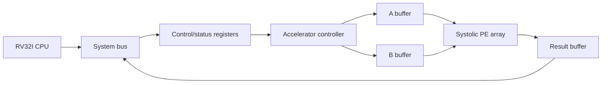

# Phase 2: Planned Systolic-Array Accelerator

Phase 2 is planned but not yet implemented. The current Phase 1 accelerator stub must not be presented as a working matrix accelerator.

## Goal

Implement a memory-mapped matrix accelerator and compare it fairly against the verified Phase 1 RV32I software baseline.

## Proposed architecture

## Planned modules

1. Memory-mapped register interface
2. Command and status controller
3. Matrix A and B operand buffers
4. Processing element with multiply-accumulate datapath
5. Systolic-array interconnect
6. Result buffer
7. Dimension, completion and overflow logic
8. CPU/accelerator integration and software driver
9. Functional and performance testbenches

## Interface requirements to freeze before RTL

- exact accelerator base address and register map;
- array dimensions and tiling method;
- signed input, accumulator and output widths;
- saturation and overflow behaviour;
- matrix layout and data-loading protocol;
- start, busy, done and error semantics;
- reset behaviour;
- result-read protocol; and
- treatment of non-multiple and partial tiles.

## Comparison method

The Phase 1 CPU and Phase 2 accelerator must use:

- the same matrices and dimensions;
- the same signed numerical rules;
- the same expected result checker;
- the same stated clock assumption;
- separately reported CPU and accelerator cycle counts;
- synthesis resource, timing and power evidence; and
- FPGA end-to-end measurements when hardware is available.

XSim host wall time will remain a verification measurement and will not be reported as FPGA execution time.

## Planned milestones

1. Freeze interface and numerical specification.
2. Verify one processing element.
3. Verify a small systolic array.
4. Add operand and result buffers.
5. Implement control/status registers.
6. Integrate the accelerator with the existing system bus.
7. Develop the CPU-side driver.
8. Run matrix functional regression.
9. Compare CPU-only and accelerator cycles.
10. Synthesize, analyze timing/resources and document results.

